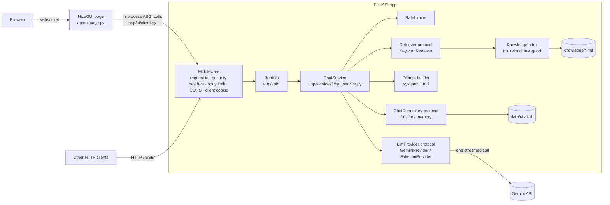
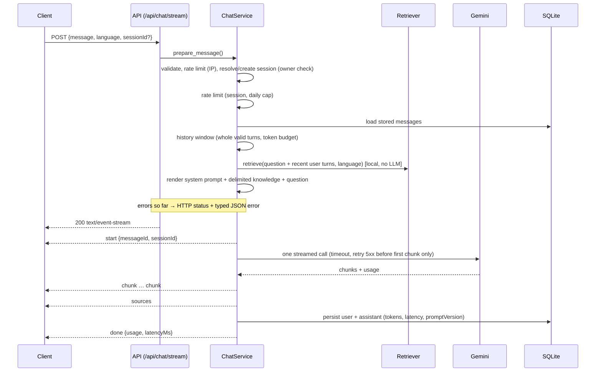

# Architecture

## Components



The UI uses the **same public API** as any other client. Its in-process client sends
requests through the whole middleware stack, with the browser's real IP and signed
cookie, and it streams. When the user presses Stop, it sends `http.disconnect`, which
aborts the Gemini call.

## Request flow (one LLM call per question)



If the provider fails, the stream sends `chunk` (a fallback in the selected language,
with emergency advice) and then `error`. The turn is stored with `error_code` and left out
of future history. On a client disconnect, the provider stream is closed and the partial
turn is stored as `CANCELLED`, an internal marker that clients never see.

## SSE contract

```
data: {"type":"start","messageId":"…","sessionId":"…"}
data: {"type":"chunk","text":"…"}
data: {"type":"sources","sources":[{"file":"schemes/pmmvy.md","title":"…","heading":"…"}]}
data: {"type":"done","messageId":"…","usage":{"input":0,"output":0},"latencyMs":0}
data: {"type":"error","code":"RATE_LIMIT","message":"…","retryAfter":30}
: heartbeat                                            (every 15 s)
```

* Success order: `start` → `chunk`… → `sources` → `done`.
* Failure order: `start` → `chunk`… (fallback text) → `error`. No `done` is sent.
* `usage` is `null` when the provider did not report token counts.
* `retryAfter` appears only on errors that have one.
* Errors before the stream starts (validation, rate limit, unknown session, not
  configured) are normal HTTP responses: `{"error": {"code", "message"}}` with the matching
  status (422 / 429 + `Retry-After` / 404 / 503).
* Headers: `Cache-Control: no-cache, no-transform` and `X-Accel-Buffering: no`.

## Error codes

| Code | HTTP | Meaning |
|---|---|---|
| `INVALID_INPUT` | 422 (413 for oversized body) | Empty, too long or malformed input; regenerating a non-last answer |
| `RATE_LIMIT` | 429 | Per-IP or per-session minute limit, daily cap, or provider 429 |
| `PROVIDER_DOWN` | 502 | Gemini error or empty reply |
| `TIMEOUT` | 504 | No chunk within `LLM_TIMEOUT_SECONDS` |
| `KB_UNAVAILABLE` | 503 | The knowledge directory could not be loaded |
| `SESSION_NOT_FOUND` | 404 | Unknown, expired or not-owned session or message |
| `NOT_CONFIGURED` | 503 | No Gemini key or model |
| `INTERNAL` | 500 | Anything else (details only in logs) |

## Sessions and ownership

A signed, `HttpOnly`, `SameSite=Lax` cookie (`cb_client`) identifies the browser. The
`sessions.client_id` column records the owner of each session. Every read, delete,
regenerate and feedback call checks the owner and returns 404 on a mismatch, so a
session's existence never leaks.

## Storage

The SQLite schema is in `app/storage/sqlite_repo.py` (`MIGRATIONS`). The database uses
WAL mode with `foreign_keys=ON`, and migrations are tracked with `PRAGMA user_version`.
Each call opens its own connection and runs in `asyncio.to_thread`. Expired sessions
(`SESSION_TTL_DAYS`) are deleted at startup and every hour, and their messages go with
them through `ON DELETE CASCADE`.

## Knowledge retrieval

`KeywordRetriever` tokenises with Unicode categories (letters, marks and digits), so Indic
words stay whole. Scoring works like this:

* An alias, id or title match gives the strongest boost. Indic aliases match inflected
  forms by substring.
* A heading match comes next (per-language heading keywords live in `domain.py`), then
  tags, then capped content frequency, then a small boost for the selected language.
* There is a relative threshold. The file's Overview chunk is always attached when
  another chunk of that file is selected.
* Selection stops at a token budget. If the whole knowledge base fits the budget, all of
  it is sent.
* Recent user turns count at half weight, which handles follow-ups like "and the documents?".

Retrieved chunks are wrapped in `<<<KNOWLEDGE …>>>` blocks. Any run of three or more angle
brackets inside data is neutralised, so file text cannot fake a delimiter.
